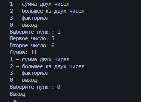
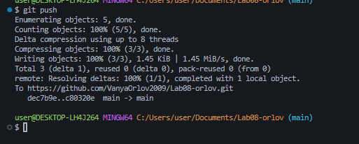

# Практическая работа №8

**ФИО:** Орлов Иван Леонидович
**Группа:** ИСП-241
**Дата:** 08.11.2026

## Что изучено

## Что изучено

- Научился писать свои методы. void просто что-то делает, например выводит текст, а метод с return отдаёт результат
- Узнал про параметры, передаёшь в метод данные, а он с ними работает. Если у метода есть тип, он обязан что-то вернуть
- Повторяющийся код теперь можно вынести в метод, чтобы не копировать его по три раза

